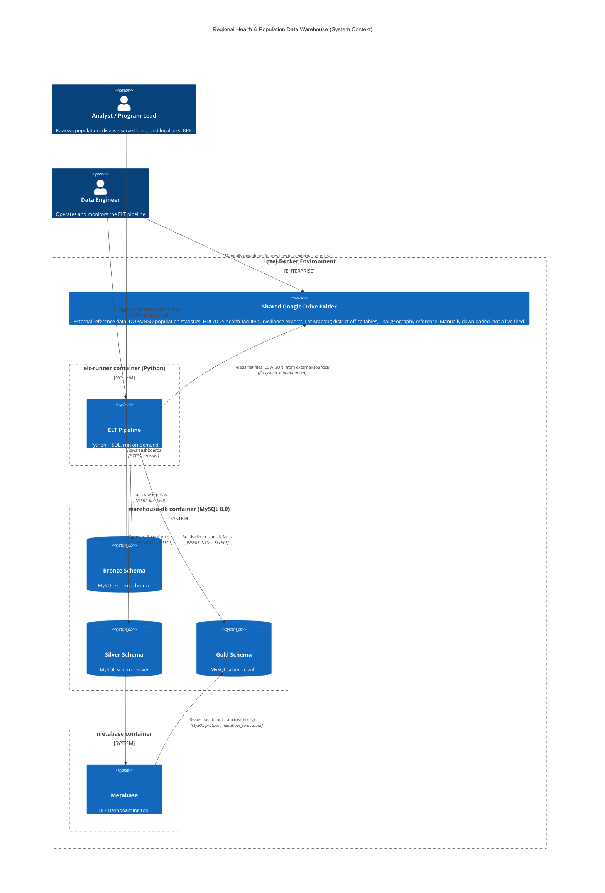

# System Architecture — C4 Context Diagram

Scope: how data flows from the shared Google Drive folder, through the
Medallion ELT pipeline, into the Metabase dashboards. This is a **C4
Level 1 (System Context)** diagram — it shows systems and major data
flows, not internal component detail (that lives in the Data Dictionary
and SQL scripts).

This warehouse has **no clinic/patient source system**. Everything in it
originates from externally-sourced reference and surveillance data
(population statistics, health-facility surveillance exports, local-area
tables) collected into one shared Drive folder.

## Flow narrative

1. **Shared Drive → external-sources/**: A data steward manually downloads
   files from the shared Google Drive folder and places them under
   `external-sources/` in this repo. There is no automated sync — if the
   Drive folder changes, someone has to re-download and re-place the
   relevant files, then rerun the pipeline.

2. **external-sources/ → Bronze**: The ELT pipeline reads each flat file
   (CSV, JSON) and lands it in `bronze.*` as close to 1:1 with the source
   structure as the format allows, plus `_bronze_loaded_at` /
   `_source_system` lineage columns. No business logic applied.

3. **Bronze → Silver**: SQL transforms cleanse and conform the data:
   cast/validate numeric and date fields, convert Thai Buddhist-Era years
   to Gregorian, deduplicate, exclude known-bad rows (e.g. pre-summed
   "Total" rows mixed into source files), and consolidate structurally
   similar tables (e.g. Lat Krabang's seven points-of-interest exports
   into one typed table).

4. **Silver → Gold**: `INSERT INTO ... SELECT` scripts build the
   dimensional tables Metabase actually queries — see
   [02_data_dictionary.md](02_data_dictionary.md) for the full table list.

5. **Gold → Metabase**: Metabase connects **exclusively** to the `gold`
   schema using a database account (`metabase_ro`) that is granted
   `SELECT`-only on `gold.*` — it has no grant on `bronze` or `silver` at
   all, so "Gold-only" is enforced by MySQL privileges, not just by
   dashboard convention.

## Design notes

- **No live source system**: unlike a typical OLTP-fed warehouse, there is
  no application writing to a source database here. Every load is a
  manual file-drop followed by a pipeline run. Treat "freshness" as "as of
  whenever someone last downloaded the Drive folder," not real-time.
- **Usage-rights governance**: a subset of this data (HDC/DDS health
  surveillance) carries an unconfirmed-redistribution-rights caveat from
  the data owner — see
  [03_external_reference_sources.md](03_external_reference_sources.md).
  That caveat is also written directly into the relevant Metabase
  dashboards' description fields, not just this doc.
- **Refresh pattern**: every layer uses a **full-refresh (truncate +
  reload)** pattern. The pipeline is idempotent — rerunning it produces
  the same Gold state.
