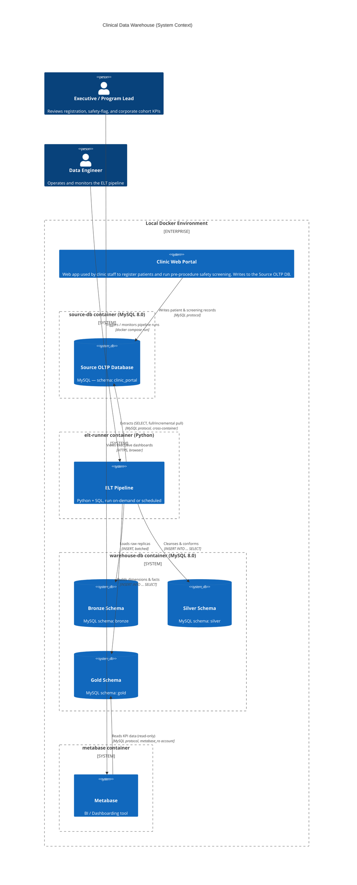

# System Architecture — C4 Context Diagram

Scope: how data flows from the live healthcare portal, through the Medallion
ELT pipeline, into the executive Metabase dashboard. This is a **C4 Level 1
(System Context)** diagram — it shows systems and major data flows, not
internal component detail (that lives in the Data Dictionary and SQL scripts).

## Flow narrative

1. **Portal → Source DB**: Clinic staff use the clinic web portal to
   register patients and capture the bilingual pre-procedure safety
   screening questionnaire. This writes to the normalized OLTP schema
   (`clinic_portal`), which the `source-db` container replicates locally
   from the provided dump.

2. **Source DB → Bronze**: The ELT pipeline extracts every source table
   **as-is** (full refresh — appropriate at this data volume) and lands it in
   `bronze.*`, 1:1 with the source structure plus `_bronze_loaded_at` /
   `_source_system` lineage columns. Bronze is the immutable, auditable
   "raw landing zone" — no business logic applied.

3. **Bronze → Silver**: SQL transforms cleanse and conform the data:
   standardize `document_type` / `patient_type` enumerations, trim and
   normalize text, cast/validate timestamps, deduplicate on natural keys
   (latest `updated_at` wins), drop soft-deleted rows, and restore proper
   types/constraints. Silver tables stay at the **source entity grain**
   (one Silver table per business entity) — this is the "single version of
   truth" layer.

4. **Silver → Gold**: `INSERT INTO ... SELECT` scripts join across Silver
   entities to populate a dimensional **Star Schema** (strictly, a
   galaxy/constellation schema with conformed dimensions shared by three
   fact tables — see [02_data_dictionary.md](02_data_dictionary.md)),
   purpose-built for the executive KPIs: registration velocity, clinical
   safety-flag rates, and corporate cohort penetration.

5. **Gold → Metabase**: Metabase connects **exclusively** to the `gold`
   schema using a database account (`metabase_ro`) that is granted
   `SELECT`-only on `gold.*` — it has no grant on `bronze` or `silver` at
   all, so "Gold-only" is enforced by MySQL privileges, not just by
   dashboard convention.

## Design notes

- **PII minimization**: direct identifiers (`id_card`, `passport_id`,
  `tel_no`, `email`, `address`) are retained in Bronze/Silver for
  operational traceability but are **deliberately excluded** from
  `Dim_Patient` in Gold. Executive KPIs operate on demographic/categorical
  attributes only (age band, sex, patient type), consistent with
  data-minimization practice for healthcare data (PDPA/HIPAA-aligned).
- **Refresh pattern**: given local/dev data volumes (~400 patients), each
  layer uses a **full-refresh (truncate + reload)** pattern rather than
  incremental CDC. The pipeline is idempotent — rerunning it produces the
  same Gold state. This is called out as the first upgrade path if the
  source system grows (see README "Scaling beyond this prototype").
