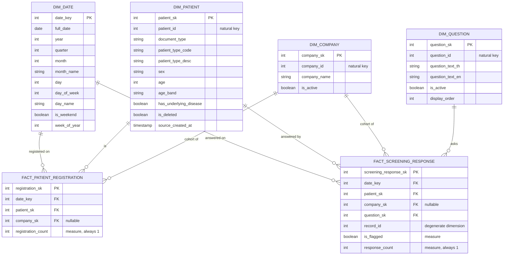

# Gold Layer — Star Schema & Data Dictionary

## 1. Design rationale

The Gold schema is a **dimensional model with conformed dimensions shared
across two fact tables** (technically a "fact constellation" / galaxy
schema — the standard real-world shape of a "star schema" once a model
supports more than one business process). Two business processes drive the
requested executive KPIs:

| Business process | Fact table | Grain | Feeds KPI |
|---|---|---|---|
| Patient enters the system | `Fact_Patient_Registration` | 1 row per patient | Registration velocity, corporate cohort penetration |
| Patient answers a pre-procedure screening question | `Fact_Screening_Response` | 1 row per (screening record × question) | Clinical safety-flag rate |

Both facts share the conformed dimensions `Dim_Date`, `Dim_Patient`,
and `Dim_Company`, so an analyst can slice any KPI by date or company
without touching the fact tables' SQL — this is what makes it a coherent
star/galaxy schema rather than unrelated marts.

## 2. Entity-Relationship Diagram



## 3. Dimension tables

### Dim_Date
Standard calendar dimension, pre-generated for 2024-01-01 → 2030-12-31.

| Column | Type | Key | Description |
|---|---|---|---|
| `date_key` | `INT` | **PK** | Surrogate key, format `YYYYMMDD` |
| `full_date` | `DATE` | | Calendar date |
| `year` | `SMALLINT` | | e.g. 2026 |
| `quarter` | `TINYINT` | | 1–4 |
| `month` | `TINYINT` | | 1–12 |
| `month_name` | `VARCHAR(20)` | | "October" |
| `day` | `TINYINT` | | 1–31 |
| `day_of_week` | `TINYINT` | | 1 (Mon) – 7 (Sun), ISO |
| `day_name` | `VARCHAR(20)` | | "Thursday" |
| `is_weekend` | `TINYINT(1)` | | 1 if Sat/Sun |
| `week_of_year` | `TINYINT` | | ISO week number |

### Dim_Patient
Grain: one row per patient (SCD Type 1 — overwrite on reload; acceptable for
demographic attributes at this scale). **Deliberately excludes direct
identifiers** (`id_card`, `passport_id`, `tel_no`, `email`, `address`,
`line_id`, names) to minimize PII exposure in the BI layer.

| Column | Type | Key | Description |
|---|---|---|---|
| `patient_sk` | `INT` | **PK** | Surrogate key |
| `patient_id` | `INT` | natural key (unique) | Source `Patient.patient_id` |
| `document_type` | `VARCHAR(20)` | | `ID_CARD` \| `PASSPORT` \| `UNKNOWN` |
| `patient_type_code` | `VARCHAR(20)` | | `employee` \| `student` \| `company_employee` \| `external` |
| `patient_type_desc` | `VARCHAR(50)` | | "Internal Employee", "Student", "Corporate Employee", "External / Visitor" |
| `sex` | `VARCHAR(10)` | | `male` \| `female` |
| `age` | `INT` | | Age in years at registration (nullable) |
| `age_band` | `VARCHAR(10)` | | `<18`,`18-29`,`30-39`,`40-49`,`50-59`,`60+`,`Unknown` |
| `has_underlying_disease` | `TINYINT(1)` | | Derived: 1 if `underlying_disease` populated |
| `is_deleted` | `TINYINT(1)` | | Derived from source soft-delete (`deleted_at IS NOT NULL`) |
| `source_created_at` | `TIMESTAMP` | | Original registration timestamp — join target for registration velocity and hour-of-day velocity |
| `zip_code` | `VARCHAR(9)` | | Postal code only (no street address) — added for geographic catchment KPIs; nullable |
| `district_code` | `INT` | | Resolved from `zip_code` via `silver.zip_code_primary_district`; NULL if zip missing/invalid/unmatched |
| `district_name_en` | `VARCHAR(100)` | | |
| `province_code` | `INT` | | Official Thai 2-digit province code (matches DOPA's `CC-CODE`) |
| `province_name_en` | `VARCHAR(100)` | | |
| `is_geo_ambiguous` | `TINYINT(1)` | | 1 if the zip code genuinely spans more than one district (17% of Thai zip codes do) — `district_code` is the most-likely match, not certain, when this is 1 |

### Dim_Company
| Column | Type | Key | Description |
|---|---|---|---|
| `company_sk` | `INT` | **PK** | Surrogate key |
| `company_id` | `INT` | natural key (unique) | Source `Company.company_id` |
| `company_name` | `VARCHAR(255)` | | Standardized (trimmed) company name |
| `is_active` | `TINYINT(1)` | | 1 if not soft-deleted |

A synthetic `company_sk = -1` ("Not Applicable / Non-Corporate") row is
seeded so fact rows for non-corporate patients (`employee`, `student`,
`external`) use a real FK instead of `NULL`, keeping joins simple in
Metabase (Kimball "zero/N-A member" pattern).

### Dim_Question
| Column | Type | Key | Description |
|---|---|---|---|
| `question_sk` | `INT` | **PK** | Surrogate key |
| `question_id` | `INT` | natural key (unique) | Source `Screening_Question.question_id` |
| `question_text_th` | `TEXT` | | Thai text, split from the bilingual source string |
| `question_text_en` | `TEXT` | | English text, split from the bilingual source string |
| `is_active` | `TINYINT(1)` | | Current questionnaire item flag |
| `display_order` | `INT` | | Questionnaire display order |

### Dim_District_Population
Not a conformed dimension joined by any fact table's FK — it's a Gold-resident
reference table keyed by `district_code` so catchment coverage-rate KPIs can
join `Dim_Patient.district_code` without leaving the Gold schema (see
[03_external_reference_sources.md](03_external_reference_sources.md) for why
that boundary matters). Grain: one row per district per year.

| Column | Type | Key | Description |
|---|---|---|---|
| `district_code` | `INT` | **PK (composite)** | Matches `Dim_Patient.district_code` |
| `year_ce` | `INT` | **PK (composite)** | Gregorian year; data spans 1993–2020 |
| `district_name_th` / `district_name_en` | `VARCHAR(100)` | | |
| `province_code` | `INT` | | |
| `province_name_th` / `province_name_en` | `VARCHAR(100)` | | |
| `male`, `female`, `total`, `house` | `INT` | | Resident population counts for that district/year |

## 4. Fact tables

### Fact_Patient_Registration
Factless-style fact (measure is a constant `1`) — grain: **one row per
patient**. Powers registration velocity (trend by `date_key`) and corporate
cohort penetration (`COUNT(*) WHERE company_sk <> -1` vs. total).

| Column | Type | Key | Description |
|---|---|---|---|
| `registration_sk` | `INT` | **PK** | Surrogate key |
| `date_key` | `INT` | FK → `Dim_Date` | Date of `Patient.created_at` |
| `patient_sk` | `INT` | FK → `Dim_Patient` | |
| `company_sk` | `INT` | FK → `Dim_Company` | `-1` if not a corporate employee |
| `registration_count` | `TINYINT(1)` | measure | Always `1`; `SUM()` in Metabase for counts |

### Fact_Screening_Response
Grain: **one row per screening answer** (one row per question per screening
visit). Powers clinical safety-flag rate.

| Column | Type | Key | Description |
|---|---|---|---|
| `screening_response_sk` | `INT` | **PK** | Surrogate key |
| `date_key` | `INT` | FK → `Dim_Date` | Date of `Screening_Record.created_at` |
| `patient_sk` | `INT` | FK → `Dim_Patient` | |
| `company_sk` | `INT` | FK → `Dim_Company` | `-1` if not a corporate employee |
| `question_sk` | `INT` | FK → `Dim_Question` | |
| `record_id` | `INT` | degenerate dim | Groups answers belonging to the same screening visit |
| `is_flagged` | `TINYINT(1)` | measure | `1` if the patient answered "yes" to this safety question |
| `response_count` | `TINYINT(1)` | measure | Always `1`; denominator for flag-rate % |

**Clinical safety flag rate** = `SUM(is_flagged) / SUM(response_count)`,
sliceable by `question_sk`, `date_key`, or `company_sk`.

## 5. Example executive KPI queries (Metabase-ready)

```sql
-- Registration velocity (weekly)
SELECT d.year, d.week_of_year, SUM(f.registration_count) AS registrations
FROM gold.Fact_Patient_Registration f
JOIN gold.Dim_Date d ON d.date_key = f.date_key
GROUP BY d.year, d.week_of_year
ORDER BY d.year, d.week_of_year;

-- Clinical safety flag rate by question
SELECT q.question_text_en,
       SUM(f.is_flagged) AS flagged_count,
       SUM(f.response_count) AS total_responses,
       ROUND(SUM(f.is_flagged) / SUM(f.response_count) * 100, 1) AS flag_rate_pct
FROM gold.Fact_Screening_Response f
JOIN gold.Dim_Question q ON q.question_sk = f.question_sk
GROUP BY q.question_text_en
ORDER BY flag_rate_pct DESC;

-- Corporate cohort penetration
SELECT c.company_name,
       SUM(f.registration_count) AS registered_patients
FROM gold.Fact_Patient_Registration f
JOIN gold.Dim_Company c ON c.company_sk = f.company_sk
WHERE c.company_sk <> -1
GROUP BY c.company_name
ORDER BY registered_patients DESC;

-- Catchment coverage rate by district (registrations vs. resident population)
-- Stays entirely inside gold.* — Metabase's metabase_ro account has SELECT
-- on gold only, so a query touching silver.* would fail from inside
-- Metabase even though it works fine from a root/elt connection.
-- Dim_District_Population is a multi-year time series (CE1993-2020) — pin
-- to one year_ce (here 2020, the latest available) or the join below will
-- fan out across every year that district has a row for.
SELECT
    dp.district_name_en, dp.province_name_en,
    COUNT(*) AS registered_patients,
    pop.total AS district_population_2020,
    ROUND(COUNT(*) * 100.0 / pop.total, 4) AS coverage_pct
FROM gold.Dim_Patient dp
JOIN gold.Dim_District_Population pop
  ON pop.district_code = dp.district_code AND pop.year_ce = 2020
WHERE dp.district_code IS NOT NULL
GROUP BY dp.district_name_en, dp.province_name_en, pop.total
ORDER BY registered_patients DESC;
```
