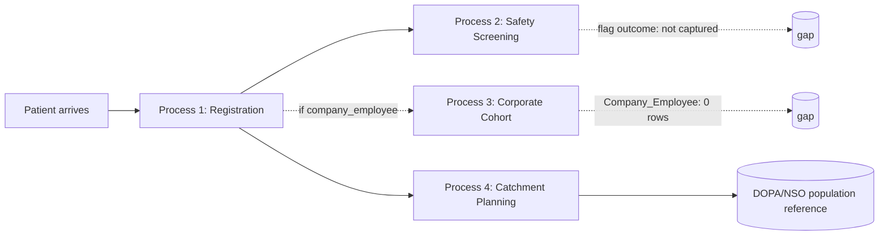

# Bottom-Up Dashboard Design: Data → Process → Metric → Dashboard

Methodology: start from what the data actually contains (not from an assumed
KPI wishlist), model the real healthcare processes that data represents,
extract metrics those processes can actually support, then assemble three
dashboards at increasing altitude — Operational, Tactical, Strategic. Every
number below was pulled live from the running warehouse on this date, not
estimated from the schema docs.

## Step 1 — Data Discovery & Profiling

### Table inventory (live row counts)

| Schema | Table | Rows | Note |
|---|---|---|---|
| gold | Dim_Patient | 376 | |
| gold | Dim_Company | 4 | incl. synthetic -1 "N/A" row |
| gold | Dim_Question | 8 | |
| gold | Dim_Date | 2,557 | |
| gold | Dim_District_Population | 54,194 | district × year, 1993–2020 |
| gold | Fact_Patient_Registration | 376 | |
| gold | Fact_Screening_Response | 3,008 | = 376 patients × 8 questions |
| bronze | Company_Employee, Employee, Student, External_Person | 0 each | **source-system gap**, not a pipeline bug |

### Key distributions

- **Date coverage**: registrations span exactly **3 calendar days** (2026-07-20 → 2026-07-22). Any "weekly/monthly trend" panel below is architecturally ready but has almost no real trend to show yet — noted per-dashboard.
- **Patient type**: Internal Employee 342 (91%), Student 27 (7%), External/Visitor 7 (2%), **Corporate Employee 0** despite `patient_type` claiming company-employee patients exist.
- **Sex**: female 273 (73%), male 103 (27%).
- **Age band**: 30-39 (98), 50-59 (96), 40-49 (88), 18-29 (80), 60+ (14).
- **Document type**: ID_CARD 373 (99%), PASSPORT 3 (1%).
- **Underlying disease declared**: 214/376 (57%) — high enough to be worth validating with whoever owns the source form (free-text field, possible over-capture).
- **Geography resolution**: 370/376 (98%) resolve to a district via the zip crosswalk; 6 don't (missing or invalid zip, e.g. one 6-digit value).
- **Corporate linkage**: 100% of registrations land on the synthetic "Not Applicable / Non-Corporate" company bucket — the corporate cohort pipeline is modeled in schema but not populated in source data.
- **Screening completion**: 376/376 (100%) of registered patients have a screening record, and **100% of screenings happen same-day as registration** — this is a single-visit workflow, not a multi-visit journey.
- **Overall safety-flag rate**: 0.60% of all responses; by age band it ranges 0%–1.30%, highest in 50-59 (1.30%, n=768 responses) — **60+ shows 0% but only 14 patients / 112 responses, too small to trust as a real effect.**
- **Population reference data**: latest year available is **2020** (6 years stale relative to today).

These findings directly shape Step 2 — I'm not modeling anything the data can't back up.

## Step 2 — Core Process Modeling (Healthcare Setting)

Four processes are visible in the data. A fifth one implied by the schema
(corporate cohort engagement) exists on paper but isn't actually operating —
that gap is itself a process-modeling finding, not something to paper over.

### Process 1: Patient Intake & Registration
**Actors**: front-desk/clinic staff, patient. **Trigger**: patient arrives
(walk-in, student batch, employee, visitor). **Steps**: capture identity
document → capture demographics (sex, age, address/zip) → classify
`patient_type` → declare underlying disease. **System of record**:
`Patient` + subtype tables (`Employee`/`Student`/`Company_Employee`/
`External_Person` — all empty except the base `Patient` row itself).
**Gold output**: `Dim_Patient`, `Fact_Patient_Registration`.

### Process 2: Pre-Procedure Safety Screening
**Actors**: clinic staff, patient. **Trigger**: immediately after
registration, same visit (confirmed: 100% same-day). **Steps**: administer
8-question bilingual safety questionnaire (allergy, fever/acute illness,
recent hospitalization, chronic disease control, pregnancy status) →
record yes/no per question. **Decision point implied but NOT captured in
data**: what happens after a flag is raised (clinical review? deferral?) —
this is a real gap in the process's data footprint, worth flagging to
whoever owns the source system if "outcome of a flagged screening" ever
needs to be measured. **System of record**: `Screening_Record` +
`Screening_Answer` + `Screening_Question`. **Gold output**:
`Fact_Screening_Response`, `Dim_Question`.

### Process 3: Corporate Cohort Engagement *(modeled, not operating)*
**Intended flow**: employer registers as `Company` → designates a `Contact`
→ enrolls employees via `Company_Employee`, linking them to `Patient`.
**Observed reality**: 3 companies and 3 contacts exist, but
`Company_Employee` has zero rows — so no patient is actually attributable
to a company even though 342 patients are typed `Internal Employee`. This
process exists structurally but has no operating data behind it right now.
Any dashboard metric built on this process must say so rather than show a
silent zero.

### Process 4: Catchment & Geographic Service Planning
**Not a per-patient operational process** — a planning-layer process that
consumes `Dim_Patient`'s resolved geography plus external DOPA/NSO
population reference data to understand service-area reach. **Actors**:
program planners, not frontline staff. **System of record**:
`silver.zip_code_primary_district` (the crosswalk) + `Dim_District_Population`.

## Step 3 — Metric Extraction

Metrics are tagged by altitude using the standard distinction: **Operational**
= "what do I act on right now," **Tactical** = "are we on track this
period, where do we adjust," **Strategic** = "are we achieving the
program's purpose." Metrics marked **(gap)** are architecturally supported
but currently return a flat zero/empty result because of the Process 3 gap
above — included because the dashboard should surface the gap, not hide it.

| # | Metric | Process | Altitude | Grounding |
|---|---|---|---|---|
| M1 | Registrations today / this hour | 1 | Operational | `Fact_Patient_Registration` × `Dim_Date`, hour from `Dim_Patient.source_created_at` |
| M2 | Registration data-completeness rate (missing zip/age at intake) | 1 | Operational | `Dim_Patient` NULL checks |
| M3 | Patients screened vs. registered today (queue backlog) | 1→2 | Operational | `Fact_Patient_Registration` vs `Fact_Screening_Response` by `patient_sk` |
| M4 | Today's flagged patients (worklist) | 2 | Operational | `Fact_Screening_Response WHERE is_flagged=1`, joined to `Dim_Question` for which question |
| M5 | Today's flag rate vs. rolling baseline (anomaly check) | 2 | Operational | same as KPI query in [02_data_dictionary.md](02_data_dictionary.md) |
| M6 | Corporate-linkage completeness (gap) | 3 | Operational | `patient_type_code='company_employee'` count with no matching `silver.company_employee` row — currently 100% unlinked |
| M7 | Registration volume trend by day/week | 1 | Tactical | `Fact_Patient_Registration` × `Dim_Date` — see data-coverage caveat |
| M8 | Registration velocity per day (DoD change, 7-day rolling avg) | 1 | Tactical | already built, see metric #9 from the earlier KPI set |
| M9 | Segment mix trend (patient_type, document_type) | 1 | Tactical | `Dim_Patient` grouped over time |
| M10 | Flag rate trend by question | 2 | Tactical | `Fact_Screening_Response` × `Dim_Question` over `date_key` |
| M11 | Screening completion rate trend | 2 | Tactical | M3 aggregated over time |
| M12 | Active corporate partners & registrations per partner (gap) | 3 | Tactical | `Dim_Company` join — currently all partners show 0 |
| M13 | Registration volume by district, period-over-period | 4 | Tactical | `Dim_Patient.district_code` over `date_key` |
| M14 | Geo-resolution completeness rate | 4 | Tactical | resolved/unresolved split from Step 1 profiling |
| M15 | Catchment coverage rate by district (registrations ÷ resident population) | 4 | Strategic | `Dim_Patient` + `Dim_District_Population`, see [02_data_dictionary.md](02_data_dictionary.md) |
| M16 | Elderly/vulnerable population share (60+) | 1 | Strategic | `age_band='60+'` share of total |
| M17 | Demographic reach equity (age×sex pyramid vs. regional population structure) | 1, 4 | Strategic | `Dim_Patient` pyramid query vs `population_reference_age_sex` |
| M18 | Population health risk profile (underlying-disease prevalence, flag rate by segment) | 2 | Strategic | M5 × `Dim_Patient` segments, e.g. the age-band cross-tab in Step 1 |
| M19 | Corporate cohort penetration into addressable workforce (gap, currently unmeasurable) | 3 | Strategic | blocked until Process 3's source data is fixed |
| M20 | Document-type mix (ID card vs. passport — migrant/foreign-worker signal) | 1 | Strategic | `Dim_Patient.document_type` |

## Step 4 — Dashboard Assembly

### 🟢 Operational Dashboard — "Today"
**Audience**: front-desk staff, shift supervisor. **Refresh**: real-time/hourly.
**Design intent**: numbers someone acts on before their shift ends, not
numbers someone reflects on next week.

| Panel | Metric(s) | Viz |
|---|---|---|
| Registrations today & this hour | M1 | Big number + hourly bar (reuse the registration-velocity-per-hour chart) |
| Intake data quality | M2 | Gauge — % complete, red below threshold |
| Screening backlog | M3 | Big number: registered-not-yet-screened count |
| Today's flagged patients | M4 | Table: patient_sk, question, time — a literal worklist |
| Flag-rate anomaly check | M5 | Number + sparkline vs. 0.60% baseline |
| Corporate-linkage alert | M6 | Red banner/number: "0% of company_employee patients linked to a company" — a known-gap indicator, not hidden |

### 🟡 Tactical Dashboard — "This Period"
**Audience**: clinic/program manager, department head. **Refresh**: daily/weekly.
**Design intent**: is the program on track this week, and where does staffing
or outreach need to adjust. **Caveat surfaced on the dashboard itself**: only
3 days of registration history exist right now, so trend panels will look
sparse until more data accumulates — this is a data-maturity note, not a
dashboard bug.

| Panel | Metric(s) | Viz |
|---|---|---|
| Registration trend | M7, M8 | Combo chart (bar + 7-day rolling avg), from the earlier registration-velocity-per-day work |
| Segment mix over time | M9 | Stacked bar, patient_type by day |
| Screening flag rate by question, trended | M10 | Line chart, one series per question |
| Screening completion rate trend | M11 | Line chart, % |
| Corporate partner performance (gap) | M12 | Table, explicitly showing all-zero rows with a note rather than omitting the panel |
| Registration volume by district | M13 | Bar chart, top districts |
| Geo-resolution completeness | M14 | Gauge, % resolved |

### 🔵 Strategic Dashboard — "Program Health"
**Audience**: executive sponsor, hospital/program leadership. **Refresh**:
monthly/quarterly. **Design intent**: is this program reaching who it's
meant to reach, and is it clinically safe at scale — not day-to-day
operations.

| Panel | Metric(s) | Viz |
|---|---|---|
| Catchment coverage by district | M15 | Choropleth-style bar ranking (see geo limitations noted in [03_external_reference_sources.md](03_external_reference_sources.md)) |
| Elderly/vulnerable share | M16 | Gauge with risk-cohort thresholds |
| Demographic reach vs. regional structure | M17 | Population pyramid, program vs. regional, side-by-side |
| Population health risk profile | M18 | Flag rate × segment heatmap (age band × question) |
| Corporate cohort penetration (gap) | M19 | Explicit "blocked — source data gap" status tile, not a fabricated number |
| Document-type / migrant-worker signal | M20 | Pie/trend, ID card vs. passport share |

## What this doesn't do yet

This is the design artifact, not the built dashboards — nothing above has
been clicked together in Metabase. If you want these built, say so and I'll
go construct them panel by panel against the live `gold` schema, the same
way the KPI queries in [02_data_dictionary.md](02_data_dictionary.md) were
validated against `metabase_ro` before being handed over.
